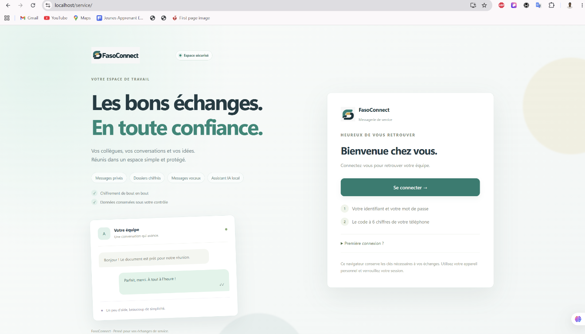

# FasoConnect



**Messagerie administrative chiffrée, appels audio/vidéo et espace de travail collaboratif.**

FasoConnect est une application de communication pour équipes de service. Elle réunit les conversations privées, les dossiers, les instructions de travail, les tâches Kanban, les messages vocaux, les appels WebRTC et un assistant IA local dans une interface française.

> Projet de démonstration et de recherche pour le Hackathon 226, édition 2026. Les comptes et données de recette doivent rester fictifs.

## Fonctionnalités

- **Messagerie privée chiffrée** avec Matrix, Olm/Megolm et vérification des appareils.
- **Dossiers de service** avec références, notes, documents et instructions regroupés dans une conversation.
- **Instructions de travail** avec destinataires, priorité, échéance, accusé de réception, progression, soumission et validation.
- **Tableau Kanban** avec les colonnes À faire, En cours, À valider et Terminées, filtres et glisser-déposer.
- **Appels audio et vidéo WebRTC natifs**, sans API média externe.
- **Appels de groupe**, partage d’écran, chat d’appel et prise de notes vocale.
- **Messages vocaux chiffrés** avec préécoute, suppression et envoi contrôlé.
- **Assistant de travail local** pour rédiger, résumer et organiser les actions avec validation humaine.
- **Interface responsive** avec landing page, thème Keycloak personnalisé et navigation mobile.
- **PWA installable** avec cache statique versionné et mise à jour contrôlée.

## Architecture

```text
Navigateur
  ├─ Client TypeScript/Vite
  ├─ Matrix JS SDK + Rust Crypto
  ├─ WebRTC natif (appels directs maillés)
  └─ IndexedDB chiffré (tâches et état local)

Caddy
  ├─ /service/       → client FasoConnect
  ├─ /auth/          → Keycloak
  ├─ /_matrix/       → Synapse
  └─ /assistant/api/ → service administratif

Services Docker
  ├─ Synapse + PostgreSQL
  ├─ Keycloak + PostgreSQL
  ├─ Admin Node.js
  └─ Ollama (IA locale facultative)
```

Le serveur conserve les événements Matrix chiffrés, les identités, les appartenances, les horaires, les adresses IP et les tailles. Les clés de chiffrement restent dans le navigateur. Aucun service média externe, serveur STUN/TURN ou fournisseur IA distant n'est requis par le client.

## Démarrage local sous Windows

### Prérequis

- Windows 10/11 ;
- Git ;
- Docker Desktop démarré avec Docker Compose ;
- Python 3 ;
- PowerShell.

Depuis la racine du dépôt :

```powershell
./Installer-Local.ps1
```

Le script prépare les secrets hors du dépôt, construit les images, démarre les services, crée les identités fictives et installe la confiance HTTPS locale si nécessaire. Ne jamais ignorer une alerte de certificat sans vérifier son origine.

Pour redémarrer une instance déjà configurée :

```powershell
./Demarrer.ps1
```

## Accès

- Application : [https://localhost/service/](https://localhost/service/)
- Administration : [https://localhost/admin/](https://localhost/admin/)
- Activation d'un compte : [https://localhost/activate](https://localhost/activate)

L'instance locale écoute sur `127.0.0.1`. `localhost` désigne l'ordinateur utilisé et ne permet pas, à lui seul, un accès depuis un téléphone. Pour un appareil distant, configurer un domaine ou une adresse IP locale, le certificat HTTPS et les variables de déploiement correspondantes.

## Comptes de recette

Les comptes fictifs sont créés par les scripts d'installation et leurs accès temporaires sont écrits hors du dépôt, dans le dossier privé indiqué par `local.settings.json`.

Pour créer un jeu séparé :

```powershell
python scripts/create_test_credentials.py
```

Le script peut créer `recette.responsable`, `recette.agent1`, `recette.agent2` et `recette.admin`. Les secrets, mots de passe temporaires, codes TOTP et fichiers d'identifiants ne doivent jamais être commités, copiés dans un ticket ou publiés dans une capture.

Pour tester plusieurs utilisateurs, utiliser des profils de navigateur distincts et vérifier les appareils Matrix avant d'échanger des messages.

## Développement frontend

```powershell
npm ci --prefix client
npm run --prefix client check
npm run --prefix client build
```

Le build génère le bundle Vite, les fichiers compressés et le service worker. Après un déploiement, recharger l'application avec `Ctrl + F5` si une ancienne version est conservée par le cache du navigateur.

## Vérifications

```powershell
node --test admin/*.test.mjs tests/*.test.mjs
python scripts/check.py
python -m unittest discover -s scripts -p test_policy.py
```

Les tests d'intégration nécessitent une instance locale et des comptes fictifs. Certains scénarios révoquent ou modifient les comptes de recette : lire [la recette jury](docs/DEMO_JURY.md) avant de les lancer.

## Sécurité et limites

- L'administration ne possède pas les clés des messages chiffrés.
- La perte du stockage local ou des clés peut rendre l'historique illisible.
- La révocation ne garantit pas la suppression des copies déjà reçues.
- Les accusés de réception ne constituent pas une certification juridique.
- Les appels WebRTC sans STUN/TURN sont adaptés à la recette réseau prévue, mais peuvent être limités derrière certains NAT ou pare-feu.
- L'audit indépendant, l'accessibilité complète et la qualification sur téléphones physiques restent à réaliser.

Signaler une vulnérabilité sans publier de secret, de clé, de contenu réel ou de données personnelles.

## Documentation

- [Architecture](docs/ARCHITECTURE.md)
- [Déploiement](docs/DEPLOIEMENT.md)
- [Sécurité](docs/SECURITE.md)
- [Vision produit](docs/VISION_PRODUIT.md)
- [Recette jury](docs/DEMO_JURY.md)
- [IA locale](docs/IA_LOCALE.md)
- [Révocation](docs/REVOCATION.md)
- [Sauvegarde et restauration](docs/SAUVEGARDE_RESTAURATION.md)
- [Vérification](docs/VERIFICATION.md)
- [Inventaire des dépendances et licences](THIRD_PARTY_NOTICES.md)

## Contribuer

Ouvrir une issue ou une pull request avec :

1. le scénario reproductible ;
2. le résultat attendu et le résultat obtenu ;
3. l'environnement utilisé ;
4. les commandes de vérification exécutées.

Ne jamais publier de secret, code TOTP, clé de chiffrement, sauvegarde, identifiant de recette ou contenu administratif réel.

## Licence

Sources originales sous [AGPL-3.0-or-later](LICENSE). Les dépendances et composants tiers conservent leurs licences respectives ; voir [THIRD_PARTY_NOTICES.md](THIRD_PARTY_NOTICES.md).
