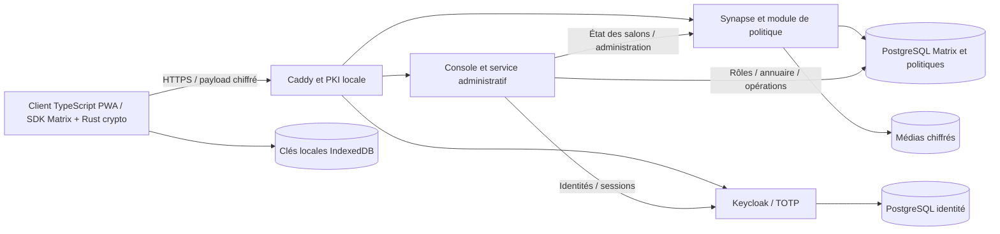

# Architecture finale

## Évolution de la version concours

Les dossiers, notes et changements d'avancement des instructions sont des événements applicatifs chiffrés par le même SDK Matrix. Aucun stockage parallèle de contenu n'est ajouté au service administratif. Le navigateur reconstitue le suivi et refuse les références incohérentes, auteurs non autorisés, conflits ou chaînes incomplètes. Les documents et vocaux sont chiffrés avant upload ; seuls leurs destinataires les déchiffrent. Le vocal ne demande ni ne stocke de langue déclarée.

Les brouillons et identifiants des tentatives restent en mémoire. Une nouvelle tentative réutilise l'événement ou la transaction Matrix, après recontrôle des accès et des appareils. Le scheduler ne relance pas automatiquement les messages. Les clés cryptographiques restent dans le stockage prévu par Rust crypto.

Les appels audio et vidéo utilisent WebRTC natif dans le navigateur, sans API ou serveur média externe. Matrix transporte uniquement la signalisation (`bf.fasoconnect.call`) dans un événement chiffré : invitation, SDP, candidats ICE et fin d'appel. Le média reste pair-à-pair ; la configuration ne fournit aucun serveur STUN/TURN, donc la connexion dépend de la joignabilité réseau directe. Les appels sont proposés uniquement dans une conversation privée à deux et nécessitent l'autorisation caméra/micro du navigateur.

L'assistant IA local est accessible depuis la messagerie. Son API vérifie l'identité et le rôle côté serveur ; elle reçoit uniquement la demande et les extraits choisis avec accord. Ollama reste dans le profil facultatif `experimental-ai`, non démarré par défaut.

Le client principal est original et utilise le SDK officiel. Le profil Docker reference-client conserve Element comme référence non exposée. Aucun backend parallèle ne transporte les messages ; le service administratif ne reçoit aucun contenu de discussion ni clé de déchiffrement.

Console : Authorization Code + PKCE, state et nonce ; validation JWT par openid-client/jose, issuer, audience et rôle administrateur. Cookie Secure/HttpOnly/SameSite, Origin et CSRF, sessions en mémoire de dix minutes. Une mutation consomme une authentification récente de moins de deux minutes. Redémarrer la console termine ses sessions.

Le compte technique Matrix reste interne, sans appareil cryptographique. Des jetons administratifs temporaires d’un membre restant créent seulement l’état et les invitations des successeurs, puis sont déconnectés ; ils n’ont aucune clé E2EE. Aucune élévation des droits du compte technique dans les salons n’est utilisée.

Rôles applicatifs et annuaire sont dans PostgreSQL. Les agents créent des conversations à deux ; les responsables gèrent les groupes. Être administrateur ne confère pas de clés de contenu.

Seul Caddy publie des ports, liés par défaut à 127.0.0.1. Réseau serveur interne ; aucun port PostgreSQL, Keycloak ou Synapse publié. TLS par autorité interne Caddy, y compris pour les appels OIDC de retour. Aucun service de certificats externe indispensable.
## Extension IA locale

Le navigateur choisit les textes déjà déchiffrés à partager avec `/assistant/api/`. Le service d’administration vérifie le jeton Matrix, l’enrôlement et les droits sur le salon, puis appelle Ollama sur un réseau Docker interne distinct. Seul `qwen3.5:2b` est utilisé, sans outil ni accès Internet. Les agents sont des spécialisations de consignes : guide avec fiches locales pertinentes, rédaction, synthèse et actions. Le résultat retourne au navigateur et peut devenir un brouillon ; son envoi ultérieur suit le chiffrement et les vérifications Matrix habituels. Aucun bot détenteur des clés des salons n’est ajouté. Détails et limites : [IA_LOCALE.md](IA_LOCALE.md).
