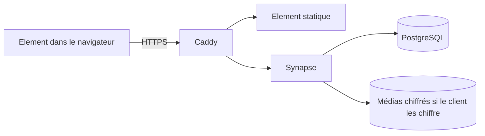

# Architecture du socle

Seul Caddy expose des ports. Les API administratives et fédération sont refusées. Aucun transport parallèle des messages. Les connexions restent fermées en attendant un fournisseur OIDC local et un second facteur imposé. L'administration devra joindre Synapse par le réseau interne sans recevoir de clés privées.
