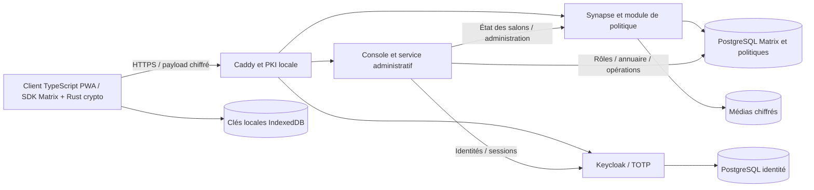

# Architecture finale

Le client principal est original et utilise le SDK officiel. Le profil Docker reference-client conserve Element comme référence non exposée. Aucun backend parallèle ne transporte les messages ; le service administratif ne reçoit aucun contenu de discussion ni clé de déchiffrement.

Console : Authorization Code + PKCE, state et nonce ; validation JWT par openid-client/jose, issuer, audience et rôle administrateur. Cookie Secure/HttpOnly/SameSite, Origin et CSRF, sessions en mémoire de dix minutes. Une mutation consomme une authentification récente de moins de deux minutes. Redémarrer la console termine ses sessions.

Le compte technique Matrix reste interne, sans appareil cryptographique. Des jetons administratifs temporaires d’un membre restant créent seulement l’état et les invitations des successeurs, puis sont déconnectés ; ils n’ont aucune clé E2EE. Aucune élévation des droits du compte technique dans les salons n’est utilisée.

Rôles applicatifs et annuaire sont dans PostgreSQL. Les agents créent des conversations à deux ; les responsables gèrent les groupes. Être administrateur ne confère pas de clés de contenu.

Seul Caddy publie des ports, liés par défaut à 127.0.0.1. Réseau serveur interne ; aucun port PostgreSQL, Keycloak ou Synapse publié. TLS par autorité interne Caddy, y compris pour les appels OIDC de retour. Aucun service de certificats externe indispensable.
